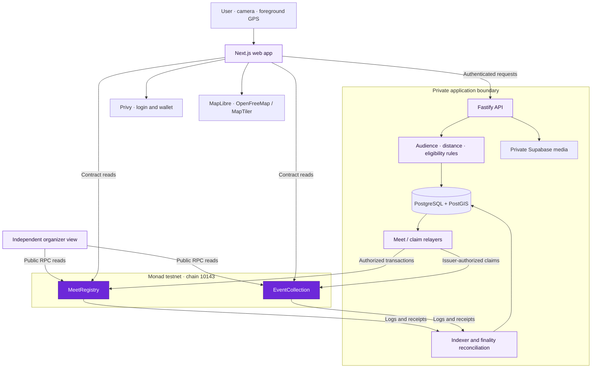
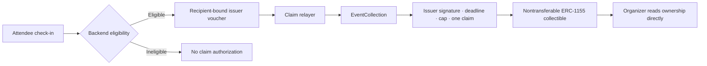

<h1 align="center">Mootz</h1>
<p align="center"><strong>Share your day. Meet in person.</strong><br>A social Map + Feed with shared memories on Monad.</p>
<p align="center"><a href="https://mootz-red.vercel.app">Website</a> · <a href="https://mootz-red.vercel.app/app">Open app</a> · <a href="docs/hackathon.md">Judge guide</a> · <a href="sc/abi/deployment.monad-testnet.json">Deployment evidence</a></p>

<p align="center">
  
  
  
  
  
  
  
  
  
  
  <a href="sc/abi/deployment.monad-testnet.json"></a>
</p>

Mootz brings everyday moments and real-world meetups into one place. Post a front-and-back photo, discover what friends share on Map or Feed, and scan a short-lived QR to create a shared **Dot**. When both people opt in, a signed Meet record can be stored on Monad. Event organizers can also issue nontransferable collectibles to eligible attendees.

Built for [Monad Blitz Jogja V2](https://monad-foundation.notion.site/Monad-Blitz-Jogja-V2-4026367594f280e2b069efefb4fb6389), 24 October 2026. This repository contains the implemented web client, backend and Solidity contracts; the separate mobile client remains planned.

[Overview](#the-problem) · [Demo](#try-mootz) · [Architecture](#architecture) · [Meet protocol](#meet-protocol) · [Contracts](#verified-testnet-contracts) · [Local setup](#run-locally) · [Limitations](#security-and-current-limitations)

## The problem

A photo feed captures what someone posted, while a map shows where they chose to share it. Neither gives two friends a mutually signed record of a moment they shared. Event memories are also often tied to one app's private attendee or inventory database.

Mootz connects these pieces: everyday paired photos, private friend sharing, short-lived QR Meets and optional records that an independent organizer can read on Monad. The app handles audience and location rules; the contracts verify signatures and enforce replay and supply constraints.

## What you can do

| Feature | Experience | Data boundary |
| --- | --- | --- |
| Paired-photo moments | Share a rear photo with a front selfie | Private media storage; API audience checks |
| Map and Feed | Browse All, Friends and Events within the content you may access | Shared display locations; verification coordinates stay private |
| Friends and reactions | Direct friend sharing, reusable selfie reactions and comments | Offchain social data |
| Meet and Dots | Scan a signed QR, accept a shared moment and receive one Dot | Backend distance and repeat limits; Dots remain offchain |
| Optional Meet records | Both people explicitly sign onchain consent | Public wallet-pair record in MeetRegistry |
| Events and collectibles | Check in, meet attendees and claim an eligible event memory | Backend eligibility; nontransferable collectible on Monad |
| Profile and frames | Posting streak, achievement frames and equipped collection frames | Offchain progress and equip state; no payouts |
| Organizer view | Inspect collection ownership and event Meet counts | Direct contract reads |

These interfaces and service modules are present in source. Their availability is separate from completion of a connected, two-device acceptance run.

## Try Mootz

| Entry point | What to inspect |
| --- | --- |
| [Website](https://mootz-red.vercel.app) | Product introduction; landing phone previews are illustrative |
| [Web app](https://mootz-red.vercel.app/app) | Map, Feed, capture, friends, Meet, profile and Event interfaces |
| [Organizer demo](https://mootz-red.vercel.app/organizer) | Contract ownership and event Meet-count reads |
| [API health](https://api.mootz.fun/health) / [readiness](https://api.mootz.fun/ready) | Service and database availability |
| [Judge guide](docs/hackathon.md) | Suggested walkthrough, evidence and remaining integration checks |

**Current status:** website and API health/readiness returned HTTP 200 during this documentation check. Both contracts are deployed and source-verified on Monad testnet. A complete two-device login → capture → Meet → transaction → collectible walkthrough still needs acceptance evidence. Deployment does not prove every integration works; see [verification](docs/verification.md).

## From a moment to a shared memory

1. **Post.** Capture a rear photo and front selfie, then share the pair with an authorized audience. Daily posting updates a profile streak without a payout.
2. **Meet.** A poster signs a Meet Offer in a QR valid for 60 seconds. The scanner signs an Accept bound to that Offer. The backend checks foreground locations are at most 100 meters apart.
3. **Keep a Dot.** A valid Meet gives both participants one offchain Meet marker. Dots are not currency. A pair can Meet again in a different approximate 200-meter area, up to five times per server day.
4. **Record by mutual consent.** Only two distinct signers who both select `RECORD_MEET` can create an onchain Meet record. Skipped or failed transactions never remove the Dot.
5. **Collect an event memory.** Eligible checked-in attendees can claim a nontransferable Event collectible. An organizer can independently read ownership and Meet counts from the contracts.

## Why Monad?

Monad provides a shared settlement layer for consented Meet records and Event collectibles. A separate organizer can read those records without querying Mootz's private inventory database. The prototype uses Monad testnet, EIP-712 signatures, a backend relayer and explicit transaction-finality reconciliation.

Photos, precise location and Dots stay offchain behind audience checks. Public Meet records reveal which wallets met. Signatures and distance checks do not prove physical presence, authentic photos or unique humans. Recording a Meet does not preserve its photos onchain.

## Verified testnet contracts

Chain ID: **10143**. Deployment date: **24 October 2026**.

| Contract | Address and verified source |
| --- | --- |
| MeetRegistry | [0x6fcdc6f98ab1ead21ae44f1e57f1ffeb5d3a49ff](https://testnet.monadscan.com/address/0x6fcdc6f98ab1ead21ae44f1e57f1ffeb5d3a49ff#code) |
| EventCollection | [0x3d368ee46756102b0e0567f846f5ad9fcdff8a01](https://testnet.monadscan.com/address/0x3d368ee46756102b0e0567f846f5ad9fcdff8a01#code) |

Both sources passed Monadscan verification; MonadVision returned partial matches. The [deployment record](sc/abi/deployment.monad-testnet.json) contains receipts, constructor arguments, roles and runtime bytecode hashes checked through an independent RPC. Testnet admin, relayer and issuer currently share one wallet. Deployment evidence does not establish a completed public Meet or collectible claim.

## Architecture

The diagram shows how the implemented modules connect. Public deployment and individual module tests do not establish that the entire path has passed live acceptance.



Business rules live in `be/`. Clients consume the [API schemas](be/specs/); signing payloads and domains come from [contract specifications](sc/specs/), and chain calls use [ABI exports](sc/abi/). Generated consumer files are checked for drift. INT-01 consumer approval remains separate from source availability.

### Meet protocol

```mermaid
sequenceDiagram
    autonumber
    participant P as Poster wallet
    participant S as Scanner wallet
    participant API as Mootz API
    participant DB as Private database
    participant R as Relayer
    participant M as MeetRegistry
    P->>API: Request Meet Offer for a published moment
    API-->>P: Offer payload and expiry
    P->>P: Sign Offer and display 60-second QR
    P-->>S: QR with signed Offer
    S->>API: Preview Offer
    API-->>S: Authorized moment preview
    S->>S: Sign Accept bound to Offer digest
    Note over P,API: Foreground location evidence from both devices
    S->>API: Signed Accept and location evidence
    API->>API: Verify signatures, expiry, distance and repeat limits
    API->>DB: Persist valid Meet and one Dot
    API-->>S: Accepted offchain Meet
    alt Both signed RECORD_MEET
        DB-->>R: Durable relay work
        R->>M: Submit Offer, Accept and acceptance attestation
        M->>M: Verify distinct signers, consent, deadlines and replay guards
        M-->>R: Receipt and recorded event
        R->>DB: Persist transaction evidence
        Note over DB,M: Reconciliation distinguishes inclusion, finality and failure
    else Either signed OFFCHAIN_MEET
        Note over DB,M: Keep the Dot; no onchain Meet record
    end
```

The QR acceptance window and the contract recording deadline are separate. The backend attests that acceptance met its rules; the contract does not check GPS. A relay failure or an opt-out leaves the accepted offchain Meet and Dot intact.

### Event collectible flow



A Meet does not automatically mint a collectible. Event tagging does not grant photo access or claim eligibility. Collection metadata is public; photos and precise location must not be placed in it.

## Repository structure

```text
Mootz/
├── fe/
│   ├── web/              Next.js web client and organizer view
│   └── app/              Reserved mobile client; framework undecided
├── be/
│   ├── src/              API, rules, database and relay/indexer workers
│   ├── specs/            Public API schemas and worker contracts
│   ├── test/             Unit and database integration coverage
│   ├── deploy/vps/       HTTPS deployment, backup and recovery setup
│   └── dev-login/        Separate development login diagnostic app
├── sc/
│   ├── src/              MeetRegistry and EventCollection
│   ├── test/             Contract and signature/replay tests
│   ├── specs/            Canonical typed data and synthetic vectors
│   └── abi/              ABI exports and public deployment evidence
├── landing/              Static product page and template credits
├── assets/brand/mootz/   Approved logo exports
└── docs/                 Product, integration and verification guides
```

## Run locally

### 1. Start the web client

Use Node.js 24 and npm 11, and keep each module's lockfile. There is no root workspace install.

```bash
git clone https://github.com/kuchikamizake05/Mootz.git
cd Mootz/fe/web
npm ci
# Copy .env.example to .env.local and set public integration values.
npm run dev
```

Open `http://localhost:3000` for the landing and `http://localhost:3000/app` for the client. Start the API and apply migrations using the [backend setup](be/README.md); the frontend defaults to `http://localhost:3001`. Configure Privy, private storage and testnet addresses for connected flows. Keep backend secrets out of frontend variables.

For a labelled UI-only preview, see the frontend's fixture mode. Fictional fixtures do not exercise wallets, camera, GPS or backend integration and must remain disabled in deployed demos.

### 2. Start the backend

In another terminal, from the repository root, use the backend's local PostGIS service. Start Docker Desktop first. These PowerShell commands preserve an existing environment file:

```powershell
cd be
npm ci
if (!(Test-Path .env)) { Copy-Item .env.example .env }
docker compose up -d db
npm run db:migrate
npm run dev
```

The API listens on `http://localhost:3001`. `/health` checks the process; `/ready` checks database readiness. Set real Privy and private media configuration in the backend environment for connected flows. Apply every pending migration, including chain-sync migrations, before enabling workers. The API does not migrate or seed on startup.

### 3. Inspect and test the contracts

Install the pinned Foundry v1.8.0 toolchain first. From a fresh terminal at the repository root:

```bash
cd sc
npm ci --ignore-scripts
npm run build
npm test
npm run check:artifacts
```

Use the existing verified testnet addresses for a connected demo. Running the local checks does not deploy contracts. Canonical typed data and public synthetic signing vectors are in `sc/specs/`; generated ABIs and deployment receipts are in `sc/abi/`.

### Environment boundaries

| Environment | Configuration | Keep in mind |
| --- | --- | --- |
| Web | [fe/web/.env.example](fe/web/.env.example) → `.env.local` | Public API origin, Privy App ID, chain and contract addresses; optional MapTiler key |
| Backend | [be/.env.example](be/.env.example) → `.env` | Private database/storage configuration, auth verification, allowed origins and worker settings |
| Contracts | [Contract README](sc/README.md) and deployment record | Signing domains must match chain 10143 and the actual deployed contracts |

Allow the exact frontend origin in both backend CORS and Privy. Use HTTPS for camera/location testing on real devices. Backend signing credentials and storage service keys must never use a `NEXT_PUBLIC_` variable.

| Checks | Instructions |
| --- | --- |
| Frontend lint, types, unit tests, build and browser checks | [Web README](fe/web/README.md) |
| Backend unit/integration tests, migrations and deployment | [Backend README](be/README.md) |
| Contract tests, ABI consistency and deployment verification | [Contract README](sc/README.md) |

## Security and current limitations

| Boundary | What is enforced | What it does not establish |
| --- | --- | --- |
| Private content | Authenticated API and audience checks | Public chain records remain visible independently |
| Meet consent | Two distinct signatures; both must carry `RECORD_MEET` | Two wallets do not prove two humans |
| Location | Backend distance check, at most 100 m, and repeat limits | The contract does not prove physical attendance |
| Replay | Unique Meet ID, nonce and signed domain/deadline checks | A signature is not a proof of photo authenticity |
| Event supply | Issuer authorization, recipient binding, claim uniqueness and cap | An event tag alone is not eligibility |
| Recovery | Persisted relay work, transaction evidence and finality reconciliation | Transaction inclusion is not the same as finality |

The current scope excludes a Dots currency, Shop, daily/shared payouts, streak rewards, social circles and an NFT for every photo. Either participant can hide a Dot; hidden Dots still count, and only the participant who hid one can restore it.

The testnet admin, relayer and issuer roles share a wallet. Operational role separation, a completed two-device live Meet/claim demonstration and production readiness remain separate work. Module tests and source verification do not constitute a comprehensive security audit. The mobile client remains unimplemented.

## Verification commands

Run checks inside their owning module; use the module READMEs for environment prerequisites.

| Module | Checks |
| --- | --- |
| `fe/web/` | `npm run lint`, `npm run typecheck`, `npm test`, `npm run check:generated`, `npm run build`, `npm run e2e` |
| `be/` | `npm run lint`, `npm run typecheck`, `npm test`, `npm run build`, `npm run check:protocol` |
| Backend database | `npm run test:db`, `npm run test:coverage` with a disposable PostGIS test database |
| `sc/` | `npm test`, `npm run lint`, `npm run build`, `npm run typecheck`, `npm run check:artifacts`, `npm run smoke:local` |

Contract checks require the pinned Foundry toolchain; local smoke starts its own disposable Anvil node. It does not prove a public testnet transaction. Backend migrations are explicit and never implied by starting the API. See [backend setup](be/README.md), [contract setup](sc/README.md) and the [judge walkthrough](docs/hackathon.md).

The checked-in [Backend CI](.github/workflows/backend.yml) runs backend checks and deployment validations. Frontend and contract commands above must be verified separately; this README does not imply they share that CI job. Use actual check output and recorded acceptance evidence for current test totals.

## Team

| Contributor | Area |
| --- | --- |
| [Wangsit](https://github.com/wngstnr-code) | Frontend and product interface |
| [Faaid](https://github.com/kuchikamizake05) | Backend, private data and relayer |
| [Diaz](https://github.com/amantajatii) | Smart contracts, tests and deployment |

## Further reading

[Product brief](BRIEF.md) · [Requirements](PRD.md) · [Architecture](docs/architecture.md) · [Decisions](docs/decisions.md) · [Map plan](docs/map-plan.md) · [Documentation index](docs/README.md) · [Brand assets](assets/brand/mootz/README.md)

Follow [CONTRIBUTING.md](CONTRIBUTING.md) and [AGENTS.md](AGENTS.md). Do not commit credentials, private photos, location exports or local archives. No public redistribution license has been selected for the whole repository; the landing template retains its own [license and credits](landing/CREDITS.md).
