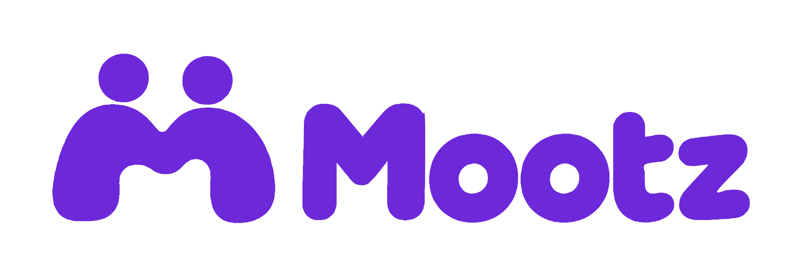

<p align="center">
  
</p>

# Mootz

**Share your day. Meet in person. Keep a record together.**

Mootz is a social Map + Feed app inspired by BeReal and Zenly/Bump. Share front-and-back photos with friends, confirm a shared moment through **Meet**, and carry consented Meet records and event collectibles on Monad.

**Status: backend and smart-contract source are implemented; product frontend is planned and end-to-end acceptance remains outstanding.** The backend includes identity, private media, friendships, moments, reactions/comments, Meet/Dots, frames, Event claims, relay recovery and chain finality workers. Contract sources, ABI and synthetic signing vectors are included. Live deployment, real-device acceptance and production readiness require separate verification. See [backend setup](be/README.md), [API interfaces](docs/interfaces.md) and [verification](docs/verification.md).

## Repository structure

```text
mootz/
├── fe/
│   ├── app/              # Mobile client — Wangsit
│   └── web/              # Web client and organizer demo — Wangsit
├── be/                   # API, private data/media, verification, relayer — Faaid
├── sc/                   # Smart contracts, tests, deployment, ABI — Diaz
├── assets/brand/mootz/    # Approved logo exports and generation notes
├── docs/                 # Product, architecture, design, and delivery plans
├── PRD.md                # Requirements and acceptance criteria
├── BRIEF.md              # Detailed product brief
└── TASKS.md              # Ownership and delivery scope
```

| Area | Owner | Scope |
| --- | --- | --- |
| [Frontend](fe/README.md) | [Wangsit](https://github.com/wngstnr-code) | [Mobile app](fe/app/README.md) and [web](fe/web/README.md), UI, capture, Map/Feed, Meet, profile, and events |
| [Backend](be/README.md) | [Faaid](https://github.com/kuchikamizake05) | Authentication, API, private storage, Meet rules, Dots, event eligibility, and transaction recovery |
| [Smart contracts](sc/README.md) | [Diaz](https://github.com/amantajatii) | MeetRegistry, EventCollection, contract tests, testnet deployment, and ABI handoff |

The web client is the initial demo target. The mobile folder reserves a separate client; its framework and delivery scope will be agreed in INT-01. Backend business logic belongs in `be/`, with both clients consuming its API.

## How it works

1. **Post a moment.** Capture a rear photo and a front selfie, then share the complete pair with friends. Daily posting updates a profile streak; it does not earn a reward.
2. **Meet together.** The poster opens a signed QR valid for 60 seconds. One other person previews that moment and signs a matching acceptance. Both devices submit a foreground location check; the backend requires a distance of at most 100 meters. Scanning does not create a friendship.
3. **Create a Dot.** Each valid Meet creates one offchain Dot for both participants. Dots are Meet markers, not currency. Map markers use an approximate area and appear only when the moment shares a location. Participants and authorized friends of the poster can see the Dot.
4. **Save by consent.** MeetRegistry records the Meet only when both participants sign `RECORD_MEET`. A failed or skipped transaction never removes the Dot. Photos and location remain offchain.
5. **Collect event memories.** Eligible checked-in attendees claim a free, nontransferable event collectible. A separate organizer demo reads ownership and event Meet counts directly from the contracts, without the Mootz inventory database.

Signatures and location checks do not prove photo authenticity, unique humans, or physical attendance. Public Meet records reveal the participating wallets; photos do not become permanent by recording a Meet.

## Product boundaries

- **Map and Feed** are the only primary tabs; **All, Friends, Events** filter authorized content.
- Direct friend sharing, reusable selfie reactions, one-level comment replies, profile streaks, and achievement frames remain in scope. There are no circles or groups.
- A pair can Meet once per approximate 200-meter verification area per server day, up to five times per day.
- Either participant can hide a Dot from everyone's map; only the participant who hid it can restore it. Hidden Dots still count.
- Achievement unlocks and equipped frames stay offchain. Event tagging does not grant photo access or collection eligibility.
- There is no Dots balance, Shop, daily/shared payout, streak reward, marketplace, or NFT for every photo.

## Planned stack

| Area | Direction |
| --- | --- |
| Web | Next.js and TypeScript in `fe/web/` |
| Mobile | Separate client in `fe/app/`; framework not selected |
| Backend | Node.js 24 + TypeScript + Fastify service in `be/`; PostgreSQL/PostGIS direction |
| Identity and storage | Privy login/wallet, PostgreSQL/PostGIS and Supabase private media |
| Maps | MapLibre; OpenFreeMap by default and user-selected MapTiler Satellite |
| Chain | Monad testnet, viem, Solidity, and Foundry in `sc/` |

Backend and contract runtime/dependency versions are pinned in their module manifests. Hosting, gas sponsorship and public deployment addresses require environment-specific configuration. MapTiler's free plan has usage limits; follow the [map plan](docs/map-plan.md) for attribution, quota handling, and fallback.

## Start here

```bash
git clone https://github.com/kuchikamizake05/mootz.git
cd mootz
```

Repository access requires permission. The backend foundation has module-local install/run/check instructions in [be/README.md](be/README.md). The smart-contract module has [reproducible local checks](sc/README.md); product frontend modules contain implementation guidance. INT-01 is still open and the signing protocol awaits cross-team approval.

Start with [TASKS.md](TASKS.md), and the [implementation plan](docs/implementation-plan.md). INT-01 freezes the API, signature payloads, and integration boundaries before FE, BE, and SC connect.

| Document | Purpose |
| --- | --- |
| [PRD](PRD.md) | Requirements ROV-01 through ROV-18 and acceptance criteria |
| [Product brief](BRIEF.md) | Product scope and context |
| [Documentation index](docs/README.md) | Reading order and sources of truth |
| [Architecture](docs/architecture.md) | Client, API, storage, contract, and relayer boundaries |
| [Map/Satellite plan](docs/map-plan.md) | Basemaps, state, privacy, attribution, and recovery |
| [Data model](docs/data-model.md) | Accounts, media, Meet, Dots, frames, and collections |
| [Onchain design](docs/onchain-design.md) | Signed Meet consent, replay controls, and event collectibles |
| [User flows](docs/user-flows.md) | Posting, Meet, profile, and event interactions |
| [Decisions](docs/decisions.md) | Approved choices and unresolved parameters |
| [Roadmap](docs/roadmap.md) | Delivery slices and evidence |
| [Development guide](docs/development-guide.md) | Module setup and integration |
| [Verification](docs/verification.md) | Scenarios and actual verification status |
| [Operations](docs/operations.md) | Demo and deployment requirements |
| [Design handoff](docs/design/README.md) | Visual direction and pen.dev prompts |
| [Brand assets](assets/brand/mootz/README.md) | PNG/SVG logos and generation notes |

## Contributing

Follow [CONTRIBUTING.md](CONTRIBUTING.md), [AGENTS.md](AGENTS.md), and your assigned issue. Keep implementation status honest and attach evidence before closing work. Do not commit credentials, private photos, location dumps, or local design exports. The root [.env.example](.env.example) is a planning inventory; use [be/.env.example](be/.env.example) for the runnable backend environment.

The initial documentation structure takes inspiration from [DuitLo](https://github.com/kuchikamizake05/DuitLo). Mootz has its own scope and implementation status. No public redistribution license has been selected.
