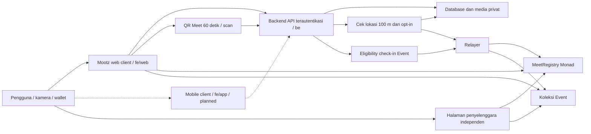

# Rancangan arsitektur

Status: proposal, belum ada modul aplikasi atau deployment. Baseline perilaku ada di [PRD](../PRD.md); batas onchain di [desain onchain](onchain-design.md).

## Batas sistem

Diagram adalah target integrasi. Dots, frame, equip, dan streak hanya di database; tidak ada contract Dots atau Shop. Halaman penyelenggara mengautentikasi penguasaan wallet dan membaca koleksi serta jumlah Meet langsung dari contract; keputusan tidak bergantung pada endpoint Mootz.

| Komponen yang diusulkan | Tanggung jawab |
| --- | --- |
| fe/web — Next.js + TypeScript | Web demo: Map/Feed, capture, QR Meet dan pemindai QR web, preview, Event, profil, frame, state recovery |
| fe/app — client mobile terpisah | Folder ownership FE; framework dan scope dikunci di INT-01, belum ada implementasi native |
| Privy | Login dan wallet (typed-data signing); API memverifikasi token di server dan binding akun-wallet |
| be — API server terpisah | API untuk kedua client; audiens, pertemanan, media, publikasi, hari server, sesi QR, cek jarak/akurasi, pemeriksaan satu Meet per pasangan per area per hari dan batas 5 per pasangan per hari, Dots (satu per Meet), frame unlock, eligibility Event; runtime/framework belum dipilih |
| Supabase | Data aplikasi dan storage privat dengan otorisasi yang diuji; service key hanya di server |
| MapLibre + OpenFreeMap + MapTiler Satellite | Map default dan Satellite pilihan pengguna; overlay berizin dan area Dot ±200 m tetap sama; key/kuota/fallback mengikuti rencana peta |
| sc — Solidity + Foundry | MeetRegistry (dua tanda tangan EIP-712, nonce, deadline, hitungan Meet) dan koleksi Event (issuer, supply cap, claim); API/ABI bukan sumber data privat |
| viem + RPC Monad | Pembacaan chain, transaksi, receipt, dan rekonsiliasi |
| Relayer / outbox | Mengirim catatan Meet dan claim koleksi, membayar gas (usulan), retry aman |

Versi runtime/paket, sponsor gas, indexing, dan hosting belum dipilih. Setiap proposal harus dibuktikan saat scaffolding.

Pembagian folder: Business API, database, verifikasi lokasi, issuer dan relayer berada di `be/`, bukan route bisnis pada FE. INT-01 menetapkan origin/CORS, autentikasi lintas client dan environment per modul. Interface API publik direncanakan di `be/specs/`, signing/types/test vector di `sc/specs/`, ekspor ABI/address di `sc/abi/`; konsumen tidak mengimpor modul server privat. Lihat [rencana tim](implementation-plan.md).

## Basemap dan overlay

MapLibre memisahkan basemap OpenFreeMap/MapTiler dari state kamera, momen/Dot, filter, serta panel. Pergantian style memulihkan overlay/handler tanpa duplikasi; MapTiler hanya dimuat pada Satellite. Payload tampilan memakai lokasi yang boleh dibagikan, tidak memuat koordinat verifikasi Meet. Request tile tetap memperlihatkan area viewport kepada provider. Lihat [rencana peta](map-plan.md) untuk atribusi, key browser berorigin restriction, kuota, dan fallback Use Map.

## Aliran data

1. Pengguna mengambil dua foto. Server menyimpan pasangan secara privat; publikasi selesai setelah kedua aset valid dan metadata tersimpan. Post eligible pertama hari itu menaikkan streak (tanpa Dots atau hak lain).
2. Setelah momen terbit, poster yang memotret teman membuka QR Meet: Meet Offer ditandatangani wallet poster (action RECORD_MEET bila opt-in, OFFCHAIN_MEET bila tidak), berlaku 60 detik, satu scanner. Event ID hanya bila kedua peserta check-in.
3. Scanner melihat preview momen itu saja, lalu menandatangani Meet Accept yang mengikat digest Offer. Meet tidak membuat pertemanan. Event tag tidak mengubah audiens.
4. Kedua perangkat mengirim lokasi foreground sekali. API menerima hanya bila jarak ≤ 100 m dan akurasi memadai; Meet yang sah (satu per pasangan per area ±200 m per hari server, maksimal 5 per pasangan per hari) menghasilkan satu Dot untuk kedua peserta di database, dan frame yang memenuhi ambang terbuka.
5. Jika kedua tanda tangan membawa RECORD_MEET, relayer mengirim Offer dan Accept ke MeetRegistry dalam deadline pencatatan (terpisah dari QR); OFFCHAIN_MEET ditolak contract. Jika tidak, Meet berhenti sebagai Dot di Mootz. Dot onchain bergembok setelah receipt.
6. Claim koleksi Event memakai eligibility check-in tersendiri dan dikirim relayer. Frame koleksi dapat dipasang; equip disimpan di database.
7. Halaman penyelenggara lain membaca kepemilikan koleksi dan jumlah Meet per event langsung dari contract.

## Batas kepercayaan dan recovery

Backend dipercaya menghubungkan akun ke wallet, memeriksa jarak dan akurasi lokasi, menyusun Offer sesuai setting opt-in, mengontrol akses foto/Dot, dan membatasi laju. Contract memverifikasi tanda tangan, domain, nonce, deadline, Meet ID unik, serta kedua action RECORD_MEET, issuer, cap, dan claim koleksi; contract tidak memverifikasi lokasi; opt-in tertegakkan lewat action RECORD_MEET yang ditandatangani. Dua wallet tidak membuktikan dua manusia; satu orang dengan dua HP masih dapat memalsukan Meet. Blockchain tidak menilai keaslian foto atau lokasi fisik.

Catatan Meet onchain memperlihatkan pasangan wallet dan waktu secara publik dan tidak dapat dihapus; karena itu opt-in kedua peserta. Media, koordinat, caption, nama, pertemanan, Dots, dan frame tetap di luar chain. Foto tidak permanen. Kunci relayer dan issuer hanya di server.

Database memakai constraint unik dan transaksi untuk Meet, Dot, dan unlock. Outbox dibuat bersama perubahan data; relayer dapat mengulang tanpa menggandakan catatan (Meet ID/nonce unik). Status onchain ditandai pending sampai receipt dan pembacaan ulang sesuai kebijakan finality yang nanti dipilih; hash transaksi dipertahankan agar refresh tidak membuat operasi baru.

Publikasi, QR/scan, jarak, Dot, pencatatan onchain, claim, dan equip mempunyai status terpisah (ROV-18). Gagal onchain tidak menghapus Dot atau posting. Penghapusan foto privat tidak menghapus riwayat transaksi.
